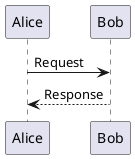
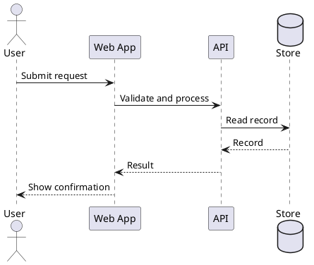
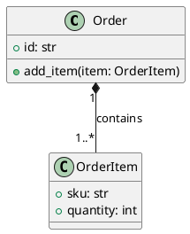
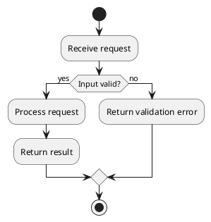
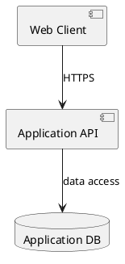

# PlantUML Documentation

**Domain:** Text-based diagrams  
**Purpose:** A quick reference for expressing diagrams as versionable text.

## What PlantUML is

PlantUML is a tool for generating diagrams from a textual description. Source
text can be reviewed in code changes, kept alongside a project, and rendered
by compatible tools. Exact syntax support and rendering options depend on the
PlantUML version and configured renderer.

Most diagrams begin with `@startuml` and end with `@enduml`. Comments begin
with a single quote:

## Sequence diagrams

Sequence diagrams show interactions over time. Participants are introduced
implicitly or declared explicitly. `->` commonly shows a message and `-->`
commonly shows a return message. Use `activate` and `deactivate` to show
lifetimes when useful.

Combined fragments such as `alt`/`else`, `opt`, and `loop` show conditional,
optional, and repeated interactions. Use labels that explain the scenario.

## Class diagrams

Class diagrams describe types and relationships. Visibility markers commonly
include `+` public, `-` private, `#` protected, and `~` package visibility.
Common relationships include association, inheritance, and composition; use
the arrow syntax supported by the version and style in use.

Use relationships to communicate domain meaning, not merely to reproduce
every implementation detail.

## Activity diagrams

Activity diagrams describe a workflow. `start` and `stop` mark its boundary;
`if`/`then`/`else` describe a branch.

## Component and deployment diagrams

Component diagrams show logical software units and their dependencies.
Deployment diagrams show nodes and deployed artifacts. Keep diagrams at a
useful level of abstraction: a system context diagram, component view, and
deployment view answer different questions and need not be combined.

## Organization and layout

Use aliases to make long labels manageable, packages or rectangles to group
related elements, and a consistent direction such as `left to right
direction` when it improves readability. PlantUML can automatically lay out
many diagrams; layout hints may be needed for complex drawings.

Prefer short labels and explicit relationships over large blocks of prose.
Split diagrams when they become difficult to scan, and keep source files
close to the code or design they document.

## Rendering and maintenance

PlantUML can be rendered with supported command-line, IDE, server, or build
integrations. Choose and pin an appropriate renderer/version for repeatable
builds. Some setups use Graphviz for certain diagram types; deployment
requirements depend on the diagram and renderer.

Treat diagrams as source artifacts:

- Review textual changes like other documentation.
- Render diagrams in the intended environment to catch syntax or layout
  problems.
- Do not put credentials, private customer data, or sensitive infrastructure
  details in a public rendering service.
- Prefer local or approved rendering for confidential diagrams.
- Keep diagrams aligned with the actual design and remove obsolete
  information.

## Further reading

- PlantUML language reference: https://plantuml.com/
- PlantUML guides: https://plantuml.com/guide
- PlantUML sequence diagrams: https://plantuml.com/sequence-diagram
- PlantUML class diagrams: https://plantuml.com/class-diagram
